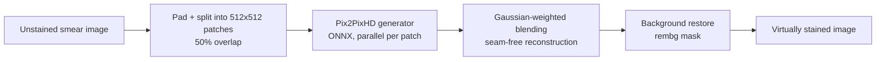

# HemAIDX

Deployment of **HemAIDX**, a portable, low-cost system for automated blood smear screening that combines **virtual staining** with **white blood cell detection**. 

This repository contains the backend service that runs the trained models on new microscope images. The models were deployed both on a web platform and on a portable device (Raspberry Pi 5 with a camera module mounted on a microscope).

## Pipeline



### Virtual staining (`hemaidx/staining.py`)
Microscope images are far larger than the generator's input size, so:
1. **Patching:** the image is padded and split into 512x512 patches with 50% overlap.
2. **Parallel inference:** each patch runs through the Pix2PixHD generator (ONNX Runtime, GPU if available) in a thread pool.
3. **Seam-free reconstruction:** patches are blended with a 2D Gaussian weight mask, so overlapping regions transition smoothly instead of showing tile edges.
4. **Background restoration:** when more than 40% of the field of view is background (detected with `rembg`), the original background is composited back, so the generator does not add colour to empty regions.

### White blood cell detection (`hemaidx/detection.py`)
1. An RT-DETR model (ONNX) predicts boxes and classes: lymphocyte, monocyte, neutrophil, others.
2. **Post-processing:** detections are filtered by confidence and de-duplicated with **cross-class NMS**, so one cell is not reported twice under different labels.

### API (`app.py`)
A FastAPI service with two endpoints:

| Endpoint | Input | Output |
|---|---|---|
| `POST /virtual-staining/` | unstained smear image | virtually stained image |
| `POST /classify/` | smear image | image with WBC boxes and labels |

## Setup

```bash
pip install -r requirements.txt
```

Place the ONNX models in `models/` (not included in this repository), or point to them with environment variables:

| Variable | Default |
|---|---|
| `HEMAIDX_STAIN_MODEL` | `models/pix2pixhd_generator.onnx` |
| `HEMAIDX_DETECT_MODEL` | `models/rtdetr_wbc.onnx` |
| `HEMAIDX_OUTPUT_DIR` | `outputs` |
| `HEMAIDX_FRONTEND_ORIGIN` | `http://localhost:5173` |

Run the service:

```bash
uvicorn app:app --host 0.0.0.0 --port 8000
```


## Team
HemAIDX was developed by a team at the Department of Computer & Software Engineering, NUST, supervised by Prof. Muhammad Usman Akram, in collaboration with clinical partners.

Trained model weights and clinical images not included.
